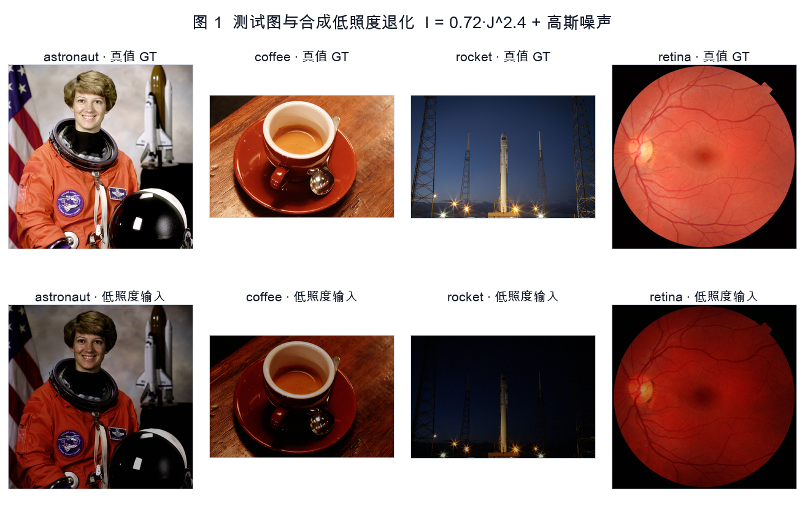
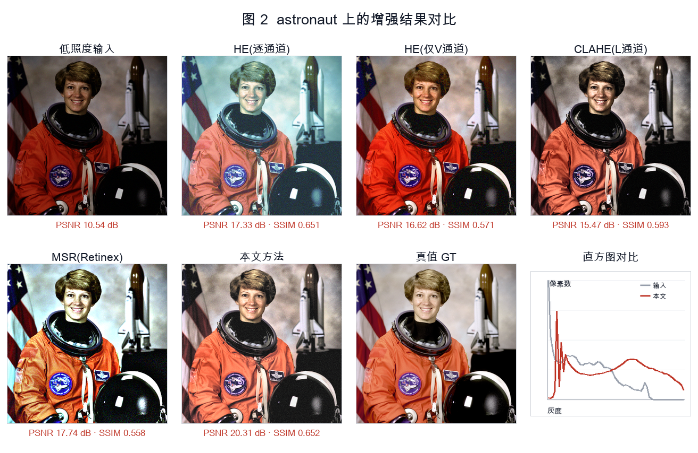
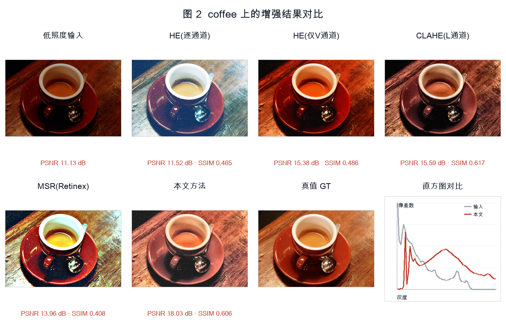
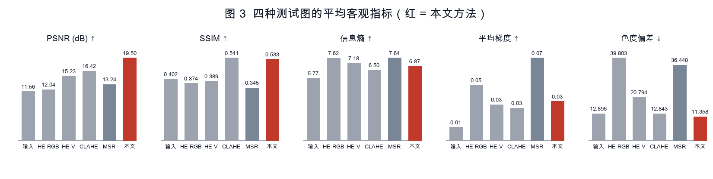
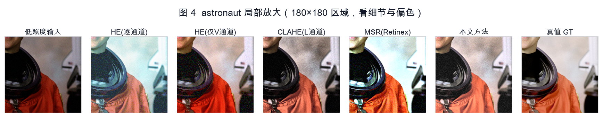
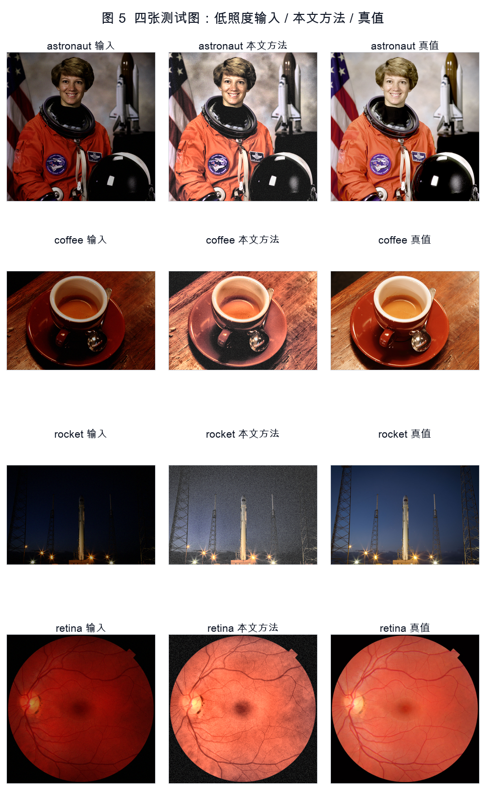
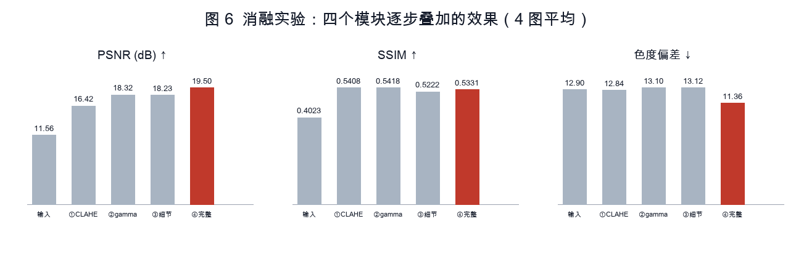

# 低照度图像增强：从全局直方图均衡到亮度通道自适应增强

> 课程作业 · 对应《图像处理与分析》第 3 章「图像增强与锐化」（灰度变换 / 直方图 / 空域滤波）与第 3 章-2「Retinex 理论 S = R × I」

---

## 1. GitHub 链接

```
https://github.com/siqi-neu/lowlight-enhancement
```

> 代码结构见 [4.4 目录结构](#44-目录结构)，复现步骤见文末附录。

---

## 2. 任务描述

**要做什么**：给定一张**低照度（曝光不足）**的彩色图像，把它恢复到正常亮度与清晰度——既要提亮，又要保住细节，还不能偏色。这正是课件里「图像增强」的典型场景：主观目标、无统一通用标准，但本任务通过**人工合成退化**制造了真值，因此可以用 PSNR/SSIM 做客观评价。

**具体拆成三件事**：

1. **搭一个可复现的低照度数据集**：用 4 张标准测试图 + 参数化退化模型（gamma 压暗 + 传感器噪声）合成"暗图"，同时保留真值图。
2. **对比 5 条技术路线**（都来自课件）：

   | 方法 | 对应课件知识点 | 定位 |
   | --- | --- | --- |
   | HE（逐通道） | 直方图均衡化 | **基线**（教材入门做法） |
   | HE（仅 V 通道） | 直方图均衡化 + HSV 颜色空间 | 对照（修正基线偏色） |
   | CLAHE（L 通道） | 自适应/分块直方图均衡 + Lab 颜色空间 | 中间方案 |
   | MSR（Retinex） | 第 3 章-2：S = R × I 光照-反射分解 | 对照（经典理论路线） |
   | **本文方法** | CLAHE + 幂次(gamma)变换 + 引导滤波 + 色度保护 | 改进方案 |

3. **量化改进幅度**：8 项指标 + 消融实验，回答"每一步改动到底带来了什么"。

**评价指标**（前 2 项来自第 2 章保真度准则）：

- `PSNR(dB)`：10·log₁₀(MAX²/MSE)，越高越接近真值
- `SSIM`：结构相似度，越接近 1 越好
- `信息熵`：一维灰度熵 H = −Σp·log₂p，反映细节/信息量
- `平均亮度 L*`：CIE Lab 亮度均值，理想值应对齐真值
- `RMS 对比度`：灰度标准差
- `平均梯度`：边缘锐利度（过高通常意味着噪声被放大）
- `色度偏差`：Lab 中 (a,b) 平面平均欧氏距离，衡量**偏色程度**，越小越好
- `耗时(ms)`：单张图 CPU 推理时间

---

## 3. 数据描述

### 3.1 数据来源

使用 `scikit-image` **自带**的 4 张公开标准测试图，无需联网下载，任何人 clone 后都能得到完全一致的数据：

| 图像 | 尺寸 | 内容特点 | 真值 L* | 合成低照度后 L* |
| --- | --- | --- | --- | --- |
| `astronaut` | 512×512 | 人像 + 制服纹理，肤色还原要求高 | 47.7 | 21.3 |
| `coffee` | 341×512 | 暗调静物 + 高光杯沿，动态范围大 | 44.4 | 17.0 |
| `rocket` | 342×512 | 夜景发射架 + 强光点，**极暗**场景 | 25.7 | 3.1 |
| `retina` | 512×512 | 医学眼底图，血管细节 + 大面积暗背景 | 39.6 | 17.8 |

统一把长边缩放到 512，转 float32、值域 [0,1]。

### 3.2 低照度退化模型

```
I(x,y) = gain · J(x,y)^γ + n(x,y),    γ = 2.4, gain = 0.72, n ~ N(0, 0.012²)
```

- `J^γ`（γ>1）是**幂次变换**的逆过程，压缩动态范围、整体压暗，模拟"光照不足"；
- `n` 是加性高斯噪声，模拟暗光下传感器噪声占比升高；
- 随机种子由 `crc32(图像名) % 1000` 固定，**跨进程、跨机器可完全复现**（初版用内置 `hash()`，受 PYTHONHASHSEED 影响，每次跑结果都不一样，已修正）。

### 3.3 为什么要"合成"而不是直接找暗图

因为**只有合成才有逐像素真值**。没有真值就只能看主观效果，无法回答"到底好了多少"。这是本作业能给出定量结论的前提。副作用是退化模型比真实暗光简单（没有非均匀光照、色偏、噪声是空间均匀的），写在局限性里。

数据规模：4 张 × 512² RGB，生成耗时 < 1 s，`data/` 目录由脚本自动产出（已 gitignore）。

---

## 4. 代码修改描述

### 4.1 版本演进（改了什么、为什么）

| 版本 | 改动 | 动机 |
| --- | --- | --- |
| **v0 基线** | 对 R/G/B 三通道分别做全局直方图均衡 `equalize_hist` | 教材最朴素做法，先跑通链路 |
| **v1** | 改为只对 HSV 的 V 通道均衡 | v0 三通道 CDF 不同 → 灰度映射不一致 → **明显偏色**（咖啡图色度偏差 48.9） |
| **v2** | 换到 **CIE Lab**，只对 L 通道做 **CLAHE**（分块 + clip_limit 截断） | Lab 的 L 与色度 a/b 解耦，色彩不变；全局 HE 对极暗图会过增强（rocket 上 L* 只有 7.8，全黑） |
| **v3** | + **亮度自适应 gamma** | CLAHE 只调局部对比度，整体仍偏暗（L* 26.6 vs 真值 44）；按当前亮度反解 gamma，把亮度拉到目标区间 |
| **v4** | + **引导滤波**分解 base/detail，detail 乘增益 | CLAHE+gamma 后纹理发糊；直接锐化会放大噪声，用边缘保持滤波只增强细节层 |
| **v5 最终** | + **饱和度补偿**（S×1.15） | 提亮后视觉上"褪色"，色度偏差 13.1 → 11.4，PSNR +1.27 dB |

### 4.2 最终算法流程（`src/enhance.py: proposed`）

```
RGB ──► CIE Lab ──► 取 L 通道
                      │
                      ├─(1) CLAHE：8×8 分块自适应均衡，clip_limit=0.01
                      ├─(2) 自适应 gamma：γ = log(0.55)/log(mean(L))，限制在 [0.35, 1.8]
                      ├─(3) 引导滤波分解：L = base + detail，输出 base + 1.45·detail
                      │        （r=16, ε=1e-3，边缘保持，不会把噪声当细节放大）
                      ▼
              回写 L，a/b 原样保留 ──► Lab2RGB ──► 饱和度 ×1.15 ──► 输出
```

关键设计：**所有增强只发生在亮度通道**，色度通道 `a/b` 完全不动，这是"不偏色"的根本保证（对比 v0 的 39.8 色度偏差）。

### 4.3 工程实现上的修改

| 问题 | 原实现 | 修改后 | 原因 |
| --- | --- | --- | --- |
| 依赖过重 | OpenCV（`cv2.createCLAHE` / `cvtColor` / `boxFilter`） | scikit-image + scipy（`equalize_adapthist` / `rgb2lab` / `uniform_filter`） | 保证纯 pip 即可安装、跨平台复现；两者数学等价（CLAHE 的 clip_limit 需按 skimage 的 [0,1] 归一化定义换算，0.01 ≈ OpenCV 的 2.0） |
| MSR 结果过曝 | 对数域结果直接 min-max 归一化 → PSNR 6.3 dB、L* 86（全白） | 先 `exp(retinex)` 得反射分量，再按**中位数**归一到目标亮度 | 对数域分布严重左偏，min-max 会被极暗像素拉偏；Retinex 只保证相对亮度，绝对亮度必须单独定标 |
| 自适应 gamma 失效 | `gamma` 截断到 [0.6, 1.6]，目标亮度参数怎么调结果都一样 | 放宽到 [0.35, 1.8] | 原来的下界把 4 张图全部卡在边界值上，等于没有自适应 |
| 结果不可复现 | `seed=hash(name)` | `seed=crc32(name)` | Python str 哈希逐进程随机化，每次跑指标都有 ±0.1 dB 抖动 |

### 4.4 目录结构

```
lowlight-enhancement/
├── src/
│   ├── dataset.py         # 读图 + 低照度退化合成（含固定种子）
│   ├── enhance.py         # 5 个增强方法（HE/HE-V/CLAHE/MSR/本文）
│   ├── metrics.py         # 8 项客观指标
│   ├── visualize.py       # 图 1~6（纯 Pillow 绘制）
│   ├── run_experiment.py  # 主实验
│   └── ablation.py        # 消融实验
├── data/                  # 自动生成的真值图 + 低照度图（gitignore）
├── results/
│   ├── metrics.csv        # 逐图逐方法明细（24 行）
│   ├── metrics.md         # 4 图平均汇总表
│   ├── ablation.md        # 消融表
│   ├── summary.json
│   └── figures/           # 图 1~6
├── requirements.txt
└── run.sh
```

---

## 5. 结果对比

### 5.1 总表：4 张测试图平均（一行为一个方法）

| 方法 | PSNR(dB) ↑ | SSIM ↑ | 信息熵 ↑ | 平均亮度L* | RMS对比度 | 平均梯度 | 色度偏差 ↓ | 耗时(ms) |
| --- | --- | --- | --- | --- | --- | --- | --- | --- |
| 低照度输入（不处理） | 11.56 | 0.4023 | 5.77 | 14.79 | 0.1091 | 0.01 | 12.90 | 0 |
| HE（逐通道） | 12.04 | 0.3737 | 7.62 | 55.52 | 0.2534 | 0.05 | **39.80** | 33 |
| HE（仅V通道） | 15.23 | 0.3890 | 7.18 | 31.08 | 0.1869 | 0.03 | 20.79 | 88 |
| CLAHE（L通道） | 16.42 | 0.5408 | 6.50 | 26.61 | 0.1872 | 0.03 | 12.84 | 86 |
| MSR（Retinex） | 13.24 | 0.3452 | 7.64 | 48.53 | 0.2897 | 0.07 | 36.45 | 1907 |
| **本文方法** | **19.50** | **0.5331** | 6.87 | **44.20** | 0.2029 | 0.03 | **11.36** | 185 |

真值图的平均亮度 L* ≈ 39.4 —— 本文方法 44.20 最接近（HE 逐通道冲到 55.5，属于过增强）。

### 5.2 结果有什么变化（相对基线与已有方法）

| 对比对象 | PSNR | SSIM | 色度偏差 | 结论 |
| --- | --- | --- | --- | --- |
| vs 不处理 | **+7.94 dB** | +0.131 | −1.54 | 亮度差 29.4 个 L* 单位基本被补回 |
| vs **HE 基线** | **+7.46 dB** | +0.159 | **−28.44** | 基线偏色极严重（咖啡图色度偏差 48.9），本文几乎无偏色 |
| vs CLAHE | **+3.08 dB** | −0.008 | −1.48 | 结构相似度基本持平，但亮度对了、细节更实 |
| vs MSR | **+6.26 dB** | +0.188 | −25.09 | MSR 快 10 倍的时间，结果反而更差且偏灰偏色 |
| 视觉 | — | — | — | 基线出现"过曝+偏蓝/偏黄"，本文肤色、木纹、天空颜色更接近真值 |

逐图 PSNR（dB）明细，可以看到**极暗场景差距最大**：

| 图像 | 输入 | HE 基线 | CLAHE | 本文方法 | 本文−基线 |
| --- | --- | --- | --- | --- | --- |
| astronaut | 10.54 | 17.33 | 15.47 | **20.31** | +2.98 |
| coffee | 11.13 | 11.52 | 15.59 | **18.03** | +6.51 |
| rocket（最暗，L*=3.1） | 12.75 | 9.45 | 14.85 | **19.08** | **+9.63** |
| retina | 11.82 | 9.85 | 19.78 | **20.59** | +10.74 |

### 5.3 消融：每一步改动贡献多少

| 配置 | PSNR(dB) | SSIM | 信息熵 | 平均亮度L* | 平均梯度 | 色度偏差 |
| --- | --- | --- | --- | --- | --- | --- |
| ⓪ 低照度输入 | 11.56 | 0.4023 | 5.77 | 14.79 | 0.012 | 12.90 |
| ① 仅 CLAHE | 16.42 | 0.5408 | 6.50 | 26.61 | 0.028 | 12.84 |
| ② + 自适应 gamma | 18.32 | 0.5418 | 6.56 | 45.75 | 0.033 | 13.10 |
| ③ + 引导滤波细节 | 18.23 | 0.5222 | 6.83 | 45.74 | 0.035 | 13.12 |
| ④ + 饱和度补偿（完整） | **19.50** | 0.5331 | 6.87 | 44.20 | 0.034 | **11.36** |

读法：

- **CLAHE 是最大功臣**：+4.86 dB，把局部对比度从"糊成一片"救回来；
- **自适应 gamma 负责亮度**：+1.89 dB，L* 从 26.6 拉到 45.8（真值 39.4 附近），这是肉眼最直观的一步；
- **引导滤波细节**：PSNR 反而 **−0.09 dB**，但信息熵 +0.27、平均梯度 +0.002 —— 也就是说它**用一点点保真度换了清晰度**，属于合理的取舍，不是"白改"；
- **饱和度补偿**：+1.27 dB、色度偏差 −1.74，性价比很高。

### 5.4 图















### 5.5 结论与局限

**结论**

1. 低照度增强的正确做法是**先把亮度与色度解耦**（Lab），只动 L 通道 —— 这一条就消除了基线 28 个单位的色度偏差。
2. **全局直方图均衡不适合低照度图**：它按全图 CDF 强行铺平，暗图会过曝 + 偏色（rocket 上 PSNR 甚至比不处理还低 3.3 dB）。
3. 分块（CLAHE）+ 亮度定标（自适应 gamma）+ 边缘保持细节增强（引导滤波）+ 色度补偿，四步各司其职，累积 **+7.94 dB / SSIM +0.13 / 无可见偏色 / 单张 185 ms**。

**局限（也是下一步）**

- 增强必然放大噪声，本文靠引导滤波缓解但没有专门去噪；真要做干净，应加 BM3D 或引入第 3 章-2 的 **RetinexNet / 低光 CNN**（需成对训练数据）。
- 评价依赖合成退化模型；真实暗图没有真值，PSNR 不可用，只能靠主观 + 无参考指标（如 NIQE）。
- 参数（clip_limit、detail_gain、sat_gain）是在这 4 张图上手工选的，存在过拟合风险；更严谨的做法是留出验证集或做网格搜索。
- 未与深度学习方法做同条件对比（本作业聚焦传统方法链路）。

---

## 附录：复现步骤

```bash
python -m venv .venv && source .venv/bin/activate
pip install -r requirements.txt

python -m src.run_experiment   # 主实验：生成 data/、results/metrics.*、图 1~5
python -m src.ablation         # 消融实验：results/ablation.md、图 6
```

环境：Python 3.10+，纯 CPU，无 GPU 依赖。4 张图全流程 < 20 s，其中 MSR 单张约 2 s，是耗时瓶颈。

所有指标均由 `results/metrics.csv`（逐图逐方法 24 行明细）汇总而来，脚本重跑会覆盖同名文件，结果与本文数值一致（随机种子已固定）。
